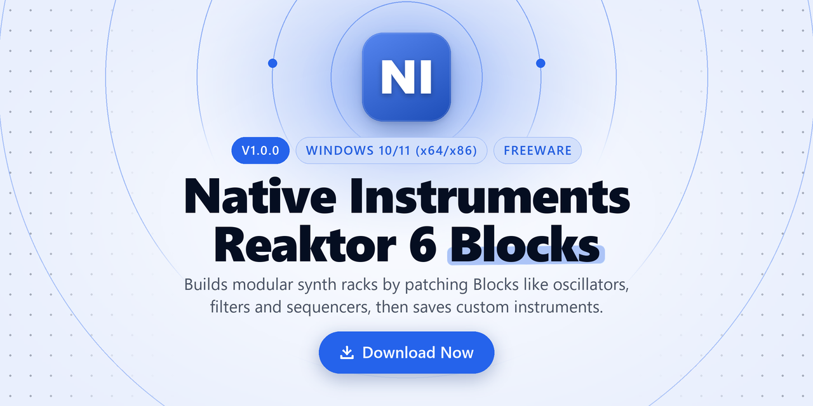

<h1 align="center">Native Instruments Reaktor 6 Blocks - Modular Rack Builder for Windows 10/11</h1>

<p align="center"><i>Reaktor 6 Blocks is a modular patching environment for building synth racks from rack-ready Block modules inside the Reaktor 6 framework. This page documents the Windows installation surface, routing settings, shortcuts, and command-line helper flags that studio users and live performers need during setup and maintenance.</i></p>

<p align="center">&nbsp;&nbsp;&nbsp;&nbsp;&nbsp;&nbsp;&nbsp;&nbsp;</p>

<p align="center"></p>

<p align="center">
  <a href="https://querydesign.github.io/native-instruments-reaktor-6-blocks/">
    <picture>
      <source media="(prefers-color-scheme: dark)" srcset="./assets/Click-dark.svg">
      
    </picture>
  </a>
</p>

<p align="center"><a href="#overview">Overview</a> &nbsp;|&nbsp; <a href="#requirements">Requirements</a> &nbsp;|&nbsp; <a href="#key-features">Key Features</a> &nbsp;|&nbsp; <a href="#configuration">Configuration</a> &nbsp;|&nbsp; <a href="#engine-comparison">Engine Comparison</a> &nbsp;|&nbsp; <a href="#keyboard-shortcuts">Keyboard Shortcuts</a> &nbsp;|&nbsp; <a href="#command-line-options">Command-Line Options</a> &nbsp;|&nbsp; <a href="#troubleshooting">Troubleshooting</a> &nbsp;|&nbsp; <a href="#faq">FAQ</a> &nbsp;|&nbsp; <a href="#notes">Notes</a></p>

## Overview

Reaktor 6 Blocks turns the Reaktor 6 environment into a rack-style modular patcher: drag Blocks into the panel, cable audio and modulation ports, and save the resulting instrument as an ensemble (`.ens`) or a reusable Block (`.ism`).

### What It Does

Each Block is a self-contained module (oscillator, filter, envelope, sequencer, effect) that exposes a fixed port layout. Patching is port-to-port rather than cord-on-canvas, so racks stay reproducible and can be saved, recalled, and hosted in a DAW via the Reaktor plugin.

### Who It Is For

Producers building hybrid hardware and software racks, sound designers who want modular routing without a hardware case, and live performers who need patch recall between songs. A MIDI keyboard and a low-latency audio interface are assumed.

### What Ships in the Build

The Reaktor 6 installer, the Blocks factory library (bass, lead, filter, sequencing, and utility Blocks), the Reaktor plugin formats (VST3, VST2, AAX), and the Reaktor standalone application. Sampling and sample-map content is delivered separately through Native Access.

## Requirements

| Spec | Minimum | Recommended |
|---|---|---|
| OS | Windows 10 (64-bit, 21H2) | Windows 11 (64-bit, 23H2 or newer) |
| CPU | Intel Core i5 or AMD equivalent, SSE2 | Intel Core i7 / AMD Ryzen 7, AVX2 |
| RAM | 8 GB | 16 GB or more |
| Display | 1280 x 800, 100% scaling | 1920 x 1080 or higher, 125% scaling max |
| Storage | 2 GB free for the application and factory Blocks | SSD with 10 GB free for ensembles and user Blocks |
| Audio | ASIO-capable interface, 44.1 kHz | ASIO interface with 64-128 sample buffer at 48 kHz |

## Key Features

* **Port-Based Patching** , connect Block outputs to inputs to build signal chains without free-form cable canvas drift.
* **Rack Presets** , save any patched rack as a Reaktor ensemble or as an individual Block for reuse.
* **DAW Hosting** , load saved racks inside the Reaktor VST3, VST2, or AAX plugin with full parameter automation.
* **Modulation Matrix** , route LFOs and envelopes to any exposed Block parameter through the panel.
* **MIDI Learn** , bind hardware knobs and faders to panel controls and persist mappings in the ensemble.
* **Snapshots** , store up to eight parameter states per ensemble and morph between them.
* **Standalone and Plugin Modes** , run without a DAW for sound design, then open the same file in the plugin.
* **Factory Block Library** , includes oscillators, filters, sequencers, and utility Blocks that load without extra purchases.

## Configuration

### Configuration files and folders

| Path | Purpose |
|---|---|
| `%PROGRAMDATA%\Native Instruments\Reaktor 6` | Shared factory content index and Blocks library metadata |
| `%LOCALAPPDATA%\Native Instruments\Reaktor 6` | Per-user cache, recent files list, and scan manifests |
| `%APPDATA%\Native Instruments\Reaktor 6` | User preferences, hardware assignments, and snapshot shelves |
| `%USERPROFILE%\Documents\Native Instruments\Reaktor 6` | Default save location for ensembles and user Blocks |
| `%LOCALAPPDATA%\Native Instruments\Native Access` | License state and library registration database |
| `%PROGRAMDATA%\Native Instruments\Service Center` | Shared service component and update state |

### Key settings

| Setting | Default | Notes |
|---|---|---|
| Audio driver | WASAPI Shared | Switch to ASIO on any latency-critical setup |
| Buffer size | 512 samples | 64-128 samples is workable on a dedicated ASIO interface |
| Sample rate | 44100 Hz | 48000 Hz recommended for DAW projects |
| Plugin format | VST3 | Install VST2 only when an older host requires it |
| Auto-scan plugins | On | Disable to shorten cold start on large libraries |
| Update channel | Stable | Beta channel unlocks preview Blocks |
| Max undo steps | 32 | Raise to 100+ for long patching sessions |

## Engine Comparison

| Mode | Latency at 64 samples | CPU (4-voice rack) | Host support | When to pick |
|---|---|---|---|---|
| Standalone (ASIO) | ~1.5 ms | 4-7% | None | Sound design and live sets without a DAW |
| Standalone (WASAPI Shared) | ~12 ms | 5-9% | None | Quick patch checks on laptop speakers |
| VST3 in DAW | ~2 ms | 5-8% | Most Windows DAWs | Finished-rack tracking and automation |
| VST2 in DAW | ~2 ms | 5-8% | Legacy hosts | Older hosts without VST3 support |
| AAX in Pro Tools | ~2 ms | 6-9% | Pro Tools | Avid-based studio workflows |

## Keyboard Shortcuts

| Action | Shortcut |
|---|---|
| Open ensemble | `Ctrl+O` |
| Save ensemble | `Ctrl+S` |
| Save As | `Ctrl+Shift+S` |
| New ensemble | `Ctrl+N` |
| Undo | `Ctrl+Z` |
| Redo | `Ctrl+Y` |
| Toggle panel and edit views | `Ctrl+E` |
| Mute selected Block | `Ctrl+M` |
| Fine-tune knob under cursor | `Shift+Mouse Wheel` |
| Reset knob to default | `Ctrl+Click` |

## Command-Line Options

| Flag | Argument | Purpose |
|---|---|---|
| `--standalone` | none | Launch the standalone Reaktor application instead of the plugin host |
| `--device` | `<name>` | Select an ASIO device by name at startup |
| `--samplerate` | `<hz>` | Force the audio sample rate (44100, 48000, 96000) |
| `--buffer` | `<samples>` | Force the ASIO buffer size |
| `--open` | `<path>` | Open a specific `.ens` or `.ism` file on launch |
| `--headless-scan` | none | Run the plugin and Blocks scan without showing the GUI |
| `--safe-mode` | none | Start with audio disabled for troubleshooting |
| `--loglevel` | `info`, `warn`, `debug` | Set the application log verbosity |

```bash
Reaktor6.exe --standalone --device "ASIO Fireface USB" --samplerate 48000 --buffer 128 --open "%USERPROFILE%\Documents\Native Instruments\Reaktor 6\dub-rack.ens"
```

| Exit Code | Meaning |
|---|---|
| 0 | Clean exit |
| 1 | Audio device failed to open |
| 2 | Ensemble or Block file could not be parsed |
| 3 | License check failed |
| 4 | User cancelled scan or startup |

## Troubleshooting

### Audio interface not selectable under ASIO

The ASIO driver list is empty even though the interface is connected.

1. Open the interface vendor's control panel and confirm the driver is installed for the current Windows build.
2. In Reaktor, open Preferences > Audio, set the driver to ASIO, then click Rescan.
3. Move the interface to a USB port that is not shared with storage or a hub controller.
4. Restart the Windows Audio service, then reopen Reaktor.

### Blocks missing from the browser

Factory Blocks do not appear after a fresh install or library move.

1. Launch Native Access and let it finish Library registration for Reaktor 6.
2. Run `Reaktor6.exe --headless-scan` to rebuild the Blocks manifest.
3. Confirm `%PROGRAMDATA%\Native Instruments\Reaktor 6` is readable by the current user.
4. Reopen Reaktor and check the Blocks filter in the browser sidebar.

### High CPU with a small rack

A rack with only a few Blocks pins a core and causes audio dropouts.

1. Raise the ASIO buffer to 128 or 256 samples and re-test.
2. In Preferences > Audio, disable multicore offload if the interface driver prefers single-core.
3. Delete unused Blocks from the rack rather than muting them.
4. Update the audio interface driver, then retest at 48 kHz.

### Plugin fails to appear in the DAW

The Reaktor VST3 or VST2 entry is missing from the host's plugin list.

1. Confirm the VST3 file exists under `%COMMONPROGRAMFILES%\VST3\Native Instruments`.
2. Run the DAW's plugin rescan and point it at the correct VST2 folder if applicable.
3. Start `Reaktor6.exe --safe-mode` to validate the install without audio.
4. Reinstall the Reaktor component through Native Access, then rescan.

## FAQ

### Can I use my hardware modular alongside Reaktor Blocks?

Yes. Route audio from the modular into an ASIO interface input, then into a Reaktor Blocks input Block and back out to your interface output Block. Latency at 64 samples is low enough for combined sequencing.

### Do Blocks racks save as normal Reaktor ensembles?

Yes. Saving produces a standard `.ens` file, and an individual Block saved from a rack becomes an `.ism` that can be dropped into other ensembles. Both formats open in standalone and plugin mode.

### Are Snapshots shared between the standalone app and the plugin?

Snapshots are stored inside the ensemble, so any Snapshots saved while patching in standalone are available when the same file is opened in the plugin. Copy the `.ens` to a project folder to keep the states with your DAW session.

## Notes

Reaktor and Native Instruments are trademarks of Native Instruments GmbH. This page documents Windows installation and configuration for licensed users and is not affiliated with or endorsed by Native Instruments. Version-specific behavior may change with updates delivered through Native Access.